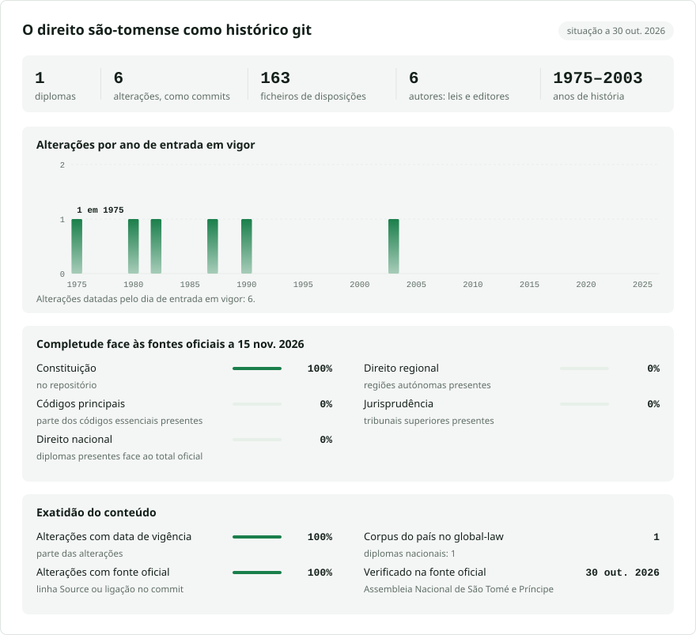

# São Tomé e Príncipe: a história do direito em git

**Português** · [English](README.en.md)

<picture>
<source media="(prefers-color-scheme: dark)" srcset="data/pt/effort-dark.svg">

</picture>

O direito de São Tomé e Príncipe como uma história git: um ficheiro por artigo, um commit por versão no dia em que entrou em vigor e, como autor do commit, o ato que fez cada alteração. `git blame` indica o ato por detrás de cada parágrafo; `git log` lista todas as alterações a um artigo; escolhendo uma data, obtém-se o texto em vigor nesse dia.

Faz parte de [lexifina/global-law](https://github.com/lexifina/global-law), uma única história git do direito de todos os países: este é o direito nacional de São Tomé e Príncipe, que o global-law lê em `sao-tome-and-principe/national/acts/`.

**O que contém por agora:** a Constituição (Constituição da República Democrática de São Tomé e Príncipe) em seis versões: tal como aprovada em 1975 e tal como revista pela Lei n.º 1/80, pela Lei n.º 2/82, pela Lei n.º 1/87, pela Lei n.º 7/90 e pela Lei n.º 1/2003, cujo texto tem um preâmbulo e 160 artigos. Nenhum outro ato, por enquanto. [`constituicao/README.md`](constituicao/README.md) lista todas as disposições, e [`data/laws.csv`](data/laws.csv) as seis leis com as respetivas datas.

Cada artigo é um ficheiro em `constituicao/` (`art-001.md` é o artigo 1.º, República Democrática de São Tomé e Príncipe), com o preâmbulo em `preambulo.md`; as divisões (partes, títulos, capítulos, secções) estão reunidas em [`constituicao/estrutura.md`](constituicao/estrutura.md), cada uma com a indicação do primeiro artigo que abrange. As revisões reutilizaram números de artigos para outras matérias, pelo que um ficheiro contém, em cada versão, o artigo que tinha esse número.

O texto está em português, tal como a Assembleia Nacional o publicou. Não faz parte deste registo nenhuma tradução inglesa.

## Perguntas como comandos git

| Pergunta | Comando |
| --- | --- |
| Todas as alterações ao artigo 1.º da Constituição | `git log -p --word-diff -- constituicao/art-001.md` |
| Que ato escreveu cada parágrafo do artigo 1.º? | `git blame constituicao/art-001.md` |
| Todas as versões do artigo 1.º, com o dia em que cada uma entrou em vigor | `git log --format="%h %(trailers:key=In-force,valueonly,separator=) %an" -- constituicao/art-001.md` |
| O artigo 1.º em vigor em 1 de janeiro de 1985 | `python tools/on.py 1985-01-01 constituicao 1` |

**Fora do git**, também disponibilizamos este registo publicamente e de forma gratuita:

- **[Perguntar ao Claude sobre o direito de São Tomé e Príncipe](https://global-law.lexifina.com/v1/try_claude?country=sao-tome-and-principe)**: abre o Claude com uma primeira pergunta já preparada.
- **[Perguntar ao ChatGPT](https://global-law.lexifina.com/v1/try_chatgpt?country=sao-tome-and-principe)**: a mesma pergunta no ChatGPT.
- **[Pesquisar o direito de São Tomé e Príncipe no nosso sítio](https://lexifina.com/law?country=sao-tome-and-principe&q=f%C3%A9rias)**: uma pesquisa por "férias", com o texto de cada disposição e as suas versões, sem necessidade de conta.
- **[API REST para programadores](https://global-law.lexifina.com/v1/search_law?query=f%C3%A9rias&jurisdiction=sao-tome-and-principe)**: a mesma pesquisa em JSON, sem chave. Veja a [documentação aqui](https://lexifina.com/api/global-law).

Ambos os assistentes leem o registo através do conector gratuito Global law (MCP, `https://global-law.lexifina.com/mcp`); da primeira vez, a conversa dá-lhe a ligação que o adiciona. Pergunte em português ou em inglês.

**Aloje-o facilmente por conta própria.** Basta ter git e Python, e as ferramentas correm na sua máquina:

```sh
git clone --depth 1 https://github.com/lexifina/global-law && cd global-law
python3 tools/countries.py add sao-tome-and-principe/national/acts
python3 tools/law.py show 2026-01-01 sao-tome-and-principe/national/acts/constituicao/art-001.md
```

Aberto no Claude Code, no Cursor, no VS Code ou no Codex, o clone inicia também um servidor MCP local com as mesmas ferramentas ([MCP.md](https://github.com/lexifina/global-law/blob/main/MCP.md)).

## Datas

Cada commit tem a data do meio-dia, hora de Africa/Sao_Tome, do dia em que a versão entrou em vigor, e indica-a no seu trailer `In-force:`:

- a Constituição de 1975 entrou em vigor com a sua aprovação, em 5 de novembro de 1975 (o seu art. 49.º), embora o Diário da República que a publicou (n.º 39) tenha a data de 15 de dezembro de 1975;
- as Leis n.º 1/80, 2/82, 1/87 e 7/90 entraram em vigor com a publicação: 7 de fevereiro de 1980, 31 de dezembro de 1982, 31 de dezembro de 1987 e 20 de setembro de 1990, as datas do Diário da República indicadas no índice da Assembleia Nacional e no art. 159.º do texto de 2003;
- a Lei n.º 1/2003 entrou em vigor no trigésimo dia após a sua publicação (art. 160.º, n.º 1) no Diário da República n.º 2, de 29 de janeiro de 2003: 28 de fevereiro de 2003. A cópia do Governo indica "n.º 1, de 26 de Janeiro de 2003"; usa-se a data da Assembleia Nacional;
- `tools/on.py` escolhe a versão por esse trailer, e não pela data do commit.

A primeira versão é atribuída à própria Constituição Política de 1975, e cada uma das seguintes à lei que a fez. As revisões de 1980, 1982, 1990 e 2003 republicaram toda a Constituição, pelo que cada uma é atribuída a todos os artigos que diferem; a Lei n.º 1/87, aos cinco artigos que substituiu. O committer é sempre a Lexifina.

## Como é verificado

- `tools/check_repo.py` relê a partir do git cada versão no dia em que entrou em vigor e no dia anterior, e ambas têm de coincidir com o corpus: 6 versões, 0 divergências, e os trailers de todos os commits são legíveis.
- Os textos são lidos da camada de texto dos PDF da Assembleia Nacional, não de digitalizações; os erros ortográficos e as gralhas de dactilografia mantêm-se tal como impressos.
- O texto de 2003 foi comparado palavra a palavra com a própria cópia do Governo. Cerca de 90 pontos diferem (grafias como *juizes*/*juízes* e algumas gralhas evidentes numa ou noutra cópia); o texto da Assembleia Nacional mantém-se tal como publicado, sem correções. [`REPRODUCE.md`](REPRODUCE.md) lista todas as decisões tomadas manualmente.
- A história só cresce por acréscimo: sem commits de fusão (merge), sem nenhum commit com data futura.

## O que não mostra

- **O direito atual.** Não foi encontrada nenhuma alteração ao texto de 2003 em nenhuma fonte oficial legível (os sítios do parlamento, do Governo, do ministério e da DGRN e os respetivos arquivos). O registo termina em 2003 e não afirma que o texto de 2003 esteja hoje em vigor.
- **Parte da Lei n.º 1/87.** Os seus novos artigos 47.º a 51.º estão aplicados; o seu primeiro bloco, que altera alíneas de um artigo cujo número a cópia oficial omite, não está, pelo que esse artigo mantém a redação de 1982 até 1990.
- **Os artigos 80.º a 82.º de 2003, aplicáveis só a partir do mandato presidencial seguinte** (art. 160.º, n.ºs 2 e 3), com um artigo 80.º transitório até lá. A fonte não indica data para isso, pelo que o texto completo de 2003 é mostrado a partir de 28 de fevereiro de 2003.
- **A Lei Fundamental e a Lei da Nacionalidade de 1975**, publicadas no mesmo ficheiro que a Constituição Política, ficam de fora.
- **Nenhum outro ato.** Os códigos, as leis ordinárias e a jurisprudência não estão aqui. As edições da DGRN de nove atos (entre eles o Código do Trabalho, o Código da Família e o Código da Estrada) foram examinadas mas ficam de fora: as suas alterações mais recentes e o fundamento para as reutilizar não estão confirmados.

## Fontes

| Fonte | Tipo | Versões anteriores | Notas |
| --- | --- | --- | --- |
| Assembleia Nacional: [Legislação Constitucional](https://web.archive.org/web/20070203155103/http://www.parlamento.st/Legisl/leg%20Constit/leg_const.htm) (parlamento.st, lido através de capturas do Internet Archive de fevereiro de 2007) | Textos oficiais: um PDF por lei constitucional, com o respetivo número do Diário da República | sim, todas as leis constitucionais tal como publicadas | Os únicos textos utilizados; o parlamento.st está fora de linha e não existe hoje nenhum portal oficial de legislação em linha |
| Governo de São Tomé e Príncipe: [constistp.pdf](https://web.archive.org/web/20070813190023/http://www.gov.st/data/filestorage/docs/constistp.pdf) (gov.st, captura do Internet Archive de agosto de 2007) | Texto oficial de 2003 | não | Apenas uma verificação cruzada palavra a palavra |

## Licença

Veja [`LICENSE`](LICENSE). As leis e os outros textos legislativos oficiais estão excluídos da proteção do direito de autor segundo a regra habitual dos códigos de direito de autor de modelo português; não foi encontrada nenhuma afirmação expressa dessa posição no próprio Decreto-Lei 02/2017 de São Tomé, pelo que se trata de uma presunção, e não de uma licença. O sítio de origem não indica condições de licença.

Nenhum modelo de IA escreveu, traduziu ou corrigiu texto jurídico, e nenhum é executado quando a história é construída; os scripts foram escritos por um modelo de IA (veja [`REPRODUCE.md`](REPRODUCE.md)).

Esta é uma tradução da versão inglesa ([README.en.md](README.en.md)); em caso de divergência, prevalece a versão inglesa.

## Mais informação

Do repositório [lexifina/global-law](https://github.com/lexifina/global-law) (páginas em inglês):

- [FEATURES.md](https://github.com/lexifina/global-law/blob/main/FEATURES.md): todas as funcionalidades e o que cada corpus tem de suportar (`git blame`, `law.py`, ferramentas MCP)
- [FAQ.md](https://github.com/lexifina/global-law/blob/main/FAQ.md): perguntas e respostas · [CONTRIBUTING.md](https://github.com/lexifina/global-law/blob/main/CONTRIBUTING.md): propor alterações · [MCP.md](https://github.com/lexifina/global-law/blob/main/MCP.md): servidor MCP · [REPRODUCE.md](https://github.com/lexifina/global-law/blob/main/REPRODUCE.md): como foi construído · [CHANGELOG.md](https://github.com/lexifina/global-law/blob/main/CHANGELOG.md)
- [FRESHNESS.md](https://github.com/lexifina/global-law/blob/main/FRESHNESS.md): quão atualizado está cada corpus · [Monitorização](https://github.com/lexifina/global-law/tree/main/monitoring): se as atualizações estão a funcionar · [WATCHING.md](https://github.com/lexifina/global-law/blob/main/WATCHING.md): como cada fonte oficial é vigiada para detetar alterações
- [performance/](https://github.com/lexifina/global-law/tree/main/performance): a rapidez das ferramentas, medida
- [visualisations/](https://github.com/lexifina/global-law/tree/main/visualisations): gráficos e ligações através do direito de todo o mundo
- [Vulnerabilidades](https://github.com/lexifina/global-law/tree/main/vulnerabilities): erros nos diplomas tal como foram publicados
